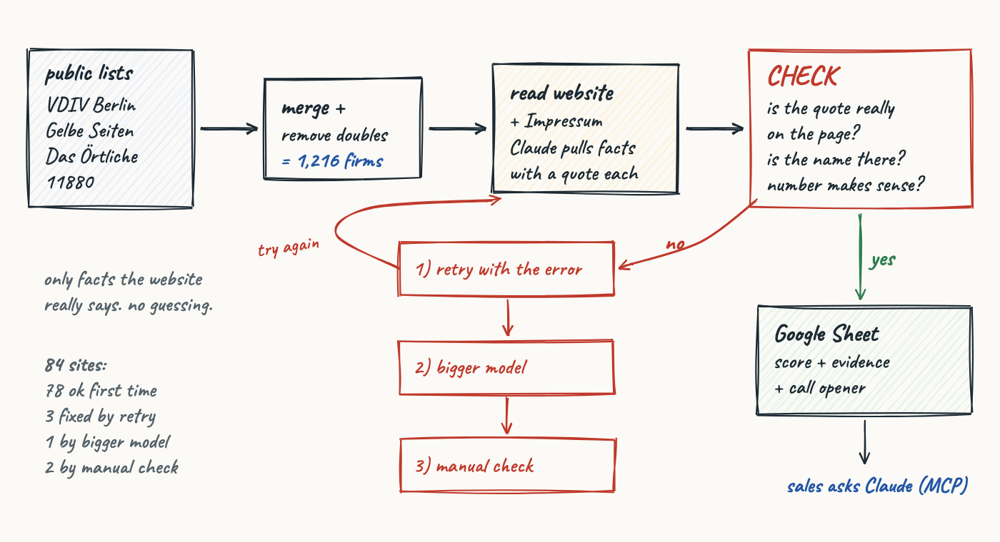

# Berlin Hausverwaltungen: lead pipeline for Heidi Systems

A small agent pipeline that finds Berlin property-management companies, checks
what their websites actually say, and ranks them as sales leads for a
metering-service provider. Built as a case study for the AI Agent Builder role
at Heidi Systems.

**Output:** [`output/heidi_berlin_hausverwaltungen.xlsx`](output/heidi_berlin_hausverwaltungen.xlsx) (opens in Google Sheets or Excel).

## Results

| | |
|---|---|
| Companies found | **1,216** unique Berlin companies from 4 public sources |
| Websites crawled | 339 reachable (384 tried) |
| Verified top leads | **79** property managers checked by the LLM pipeline: all 79 with a named decision maker or VDIV contact, 35 with a personal email |
| Decision-maker precision | **100 %** on an 18-site labelled test set, **8/8** in a live spot check |
| Estimated Berlin market | ~3,800–4,200 Hausverwaltungen (capture–recapture, see below) |
| LLM cost | low-cost by design: small model first, stronger model only on failures, hard budget cap in code |

## Architecture



### The check-and-fix loop

Every value the model returns must come with a quote from the website, and
`validate()` in `src/extract.py` checks that the quote, and every person's name,
appears **verbatim** in the text the model was given. This is what stops the
model from inventing contacts. Further checks: JSON schema, plausible ranges
(units, founding year, headcount), and "the number must appear in its own
evidence quote" (which caught the model adding two numbers together).

A failed check is not the end:

1. **Retry** with the exact error messages appended to the prompt.
2. **Escalate** to a stronger model with the same feedback.
3. **Human review:** keep only the fields that passed, flag the row, and record
   any manual fix in `data/corrections.csv`, which is applied on top of the model
   output and listed in the sheet. Nothing is edited silently.

Every attempt is logged in `data/check_log.jsonl`. Final run (84 sites): 78 passed first time, 3 fixed by retry, 1 fixed by
escalation, 2 flagged and resolved by human review.

### Evaluation

`data/pilot_labels.csv` holds a test set of 18 sites with the correct answers written down before scoring. `src/evaluate.py` scores the
extractor against them. Three prompt/code iterations:

| Version | Change | Retries needed | DM recall | DM precision |
|---|---|---|---|---|
| v1 | first prompt | 3/18 | 90 % | 100 % |
| v2 | Impressum fix, prompt rules | 6/13 (crashed on escalation) | — | 100 % |
| v3 | reason field, multi-quote evidence, "never add numbers" | **0/18** | **95 %** | **100 %** |

Where the model and the labels disagreed, the source text decided; corrected
labels are marked `[label corrected after adjudication]`.

A further 8 random top leads were re-read on the live website, outside the
pipeline: all decision makers matched (`data/spotcheck.csv`).

## KPIs

| KPI | Weight | Why it matters for Heidi |
|---|---|---|
| Size fit (units) | 20 | 300–2,000 units: enough meters to matter, small enough to switch fast |
| Rental focus | 15 | landlord decides alone; a WEG switch needs an owners' vote |
| VDIV member | 15 | Heidi is a VDIV Kooperationspartner: warm channel |
| Reachable decision maker | 15 | a named person to call, more if the email is personal |
| Old building stock | 15 | older meters, more pressure from the 31.12.2026 retrofit deadline (HeizkostenV §5) |
| Digital readiness | 10 | portal users adopt Heidi's dashboard and APIs more easily |
| Workload (hiring) | 10 | stretched teams value automated billing |

Unknown values score a neutral 0.5, and `confidence` shows how much of a score
rests on observed data. The weights are assumptions until Heidi's own won/lost
deals can be used to fit them.

**Dropped:** current metering provider (ista, Techem, …). It would be the best
signal, but 0 of 18 pilot websites name it, so it is the first question for the
sales call instead.

## Market size

Two lists that are collected independently, plus their overlap, give a rough
population estimate (Lincoln–Petersen / Chapman):

* VDIV × Gelbe Seiten: ~3,800 · VDIV × Das Örtliche: ~4,200

So the 1,216 found here are roughly 30 % of the market. Gelbe Seiten and Das
Örtliche overlap heavily (383 companies) because they share a publisher's data;
treating them as independent would wrongly suggest only ~1,100 companies.

## Data sources and rules followed

| Source | What it gives | Notes |
|---|---|---|
| VDIV Berlin-Brandenburg member list | 289 members, named contact person, often personal email | public page |
| Gelbe Seiten | 609 listings, website, rating | robots.txt respected |
| Das Örtliche | 905 listings, geo-coordinates | robots.txt allows all |
| 11880 | first 50 results | page 2+ returns 403: automated paging is blocked, so it was not bypassed |
| Company websites | Impressum, services, size, portal, jobs | ≤6 pages per site, polite delays |

Only business data published by the companies themselves is used. Outreach
should start by phone or LinkedIn: in Germany, cold emailing businesses without
prior consent is restricted (UWG §7).

## Run it

```bash
pip install requests beautifulsoup4 pandas openpyxl anthropic
python src/collect_vdiv.py && python src/collect_gelbeseiten.py
python src/collect_oertliche.py && python src/collect_11880.py
python src/merge.py && python src/prefilter.py
python src/crawl.py && python src/crawl.py --retry-failed
python src/score.py                                  # free ranking
python src/extract.py --ids-file <domains.txt>       # needs ANTHROPIC_API_KEY in .env
python src/evaluate.py && python src/score.py && python src/build_sheet.py
```

The budget cap is `BUDGET_USD` in `src/extract.py`. Results are cached per domain,
so re-runs only pay for new or failed sites.

### What's in the repo

Code in `src/`, the sheet in `output/`, and the files behind the numbers above:
`data/leads.csv` (all scored leads, also used by the MCP server),
`data/pilot_labels.csv`, `data/eval_report_v*.json`, `data/spotcheck.csv`,
`data/corrections.csv`, `data/check_log.jsonl` and `data/merge_report.json`.
Raw crawls and directory dumps are not included.

### Ask the data from Claude (MCP)

```json
{
  "mcpServers": {
    "heidi-berlin-leads": {
      "command": "uv",
      "args": ["run", "--python", "3.12", "--with", "mcp<2", "--with", "pandas",
               "python", "/ABSOLUTE/PATH/heidi-case-study/src/mcp_server.py"]
    }
  }
}
```

Tools: `search_leads`, `get_lead`, `explain_score`, `market_overview`. For example:
*"Rental-focused VDIV members with 500–2,000 units and a named Geschäftsführer"*.

## Known limits

* Unit counts are stated on only 25 of the 79 top leads' websites. Elsewhere,
  size comes from headcount or stays unknown.
* 881 of the 1,216 companies have no website in the sources, so they carry only
  directory data and a low-confidence score.
* Weights are not fitted to real outcomes yet.

## Next steps at Heidi

1. Fit the KPI weights on Heidi's won and lost deals.
2. Push the leads into the CRM and re-run weekly, with alerts for new companies,
   hiring and website changes.
3. Add a city with one setting. The sources are national.
4. Log call outcomes ("current provider", "contract end") back into the data, so
   the most important unknown becomes known over time.
